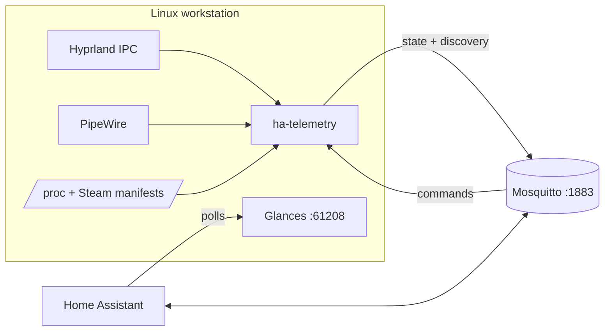

# Omarchy ↔ Home Assistant

Two-way integration between an [Omarchy](https://omarchy.org/) (Hyprland) workstation
and Home Assistant:

- **System statistics** — Glances is polled by the built-in HA integration.
- **Activity and context** — a small service publishes the focused app, workspace,
  Steam game, Teams meeting and microphone state over MQTT discovery.
- **Control** — HA can silence notifications, toggle night light, keep the machine
  awake, and lock the screen.



Tested with Omarchy / Hyprland 0.56.2, Glances 4.5.8, Home Assistant 2026.10.2,
Arch Linux. Anything outside Omarchy still works if you replace the `omarchy`
commands in the control section with your own.

## Requirements

- Home Assistant with the **MQTT** integration and a broker (Mosquitto add-on or
  an external broker).
- Arch-based desktop with Hyprland, `systemd --user`, and Python 3.
- Omarchy for the control actions (`omarchy-shell`, `omarchy toggle`,
  `omarchy system lock`); the telemetry entities work without it.
- The workstation's LAN IP. Reserve it in DHCP; both integrations point at it.

## Quick start (installer)

```bash
git clone https://github.com/<you>/omarchy-home-assistant.git
cd omarchy-home-assistant
./install.sh --verbose
```

The installer runs as your desktop user and calls `sudo` only for package
installation and the ufw rule. It:

- installs `glances`, `python-fastapi` and `uvicorn` if missing;
- adds a ufw rule for port 61208 from the detected LAN subnet;
- copies `/etc/glances/glances.conf` and applies the entity-trimming patch
  (existing user configs are kept untouched);
- installs, enables and restarts the Glances user unit;
- creates the Python venv, prompts for the MQTT broker/username/password,
  writes `mqtt.env` with mode 600, and installs/enables the bridge;
- starts the bridge only when real credentials are present.

Existing `~/.config/ha-telemetry/mqtt.env` is never overwritten, and the password
is never accepted as a command-line argument (hidden prompt or `MQTT_PASS`
environment variable).

| Option | Effect |
|---|---|
| `-v, --verbose` | print every command before running it |
| `-n, --dry-run` | show the full plan, change nothing |
| `-y, --yes` | skip the confirmation prompt |
| `--no-system` | skip packages and the ufw rule |
| `--skip-glances` | leave Glances alone |
| `--skip-mqtt` | leave the bridge alone |
| `--no-start` | enable units without starting/restarting |
| `--subnet CIDR` | override the detected LAN subnet for ufw |
| `--mqtt-host HOST` | broker address for the initial env file |
| `--mqtt-user USER` | MQTT username for the initial env file |
| `--mqtt-pass-file FILE` | read the password from the first line of FILE |

Unattended example (keeps the secret out of shell history):

```bash
printf 'secret\n' > ~/.config/ha-telemetry/pw
chmod 600 ~/.config/ha-telemetry/pw
MQTT_PASS_FILE=~/.config/ha-telemetry/pw ./install.sh --yes \
  --mqtt-host 192.168.1.10 --mqtt-user workstation
```

Inline `MQTT_PASS='...'` also works but lands in shell history; prefer the hidden
prompt or a mode-600 file.

The installer does not change Home Assistant itself: add the Glances integration
once, and MQTT discovery picks up the device automatically.

---

## 1. System statistics (Glances)

Glances exposes a small HTTP API; HA's official **Glances** integration polls it.

### Install and run

```bash
omarchy pkg add glances python-fastapi uvicorn
```

`python-fastapi` and `uvicorn` are optional dependencies required for Glances'
web/REST mode.

Allow the HA host (adjust the subnet) to reach port 61208:

```bash
sudo ufw allow from 192.168.1.0/24 to any port 61208 proto tcp comment 'glances for home assistant'
```

Install the user service from this repo:

```bash
mkdir -p ~/.config/systemd/user
cp systemd/glances.service ~/.config/systemd/user/
systemctl --user daemon-reload
systemctl --user enable --now glances
```

Verify:

```bash
curl -s http://127.0.0.1:61208/api/4/all | jq '.cpu, .mem'
```

### Add to Home Assistant

Settings → Devices & Services → **Add Integration** → **Glances**

| Field | Value |
|---|---|
| Host | workstation LAN IP (e.g. `192.168.1.50`) |
| Port | `61208` |
| SSL | off |
| Username / password | empty (Glances has no auth by default) |

Give the workstation a DHCP reservation, otherwise the integration breaks when
the lease changes. Do **not** expose 61208 to the internet — Glances is
unauthenticated.

### Trim the entity list

By default Glances exposes per-core CPU, per-device disk I/O, process counts and
one filesystem entry per btrfs subvolume. To keep only CPU total, memory, swap,
load, real disks, temperatures, GPU, network and uptime:

> Glances reads only the **first** config file it finds. A user config
> (`~/.config/glances/glances.conf`) completely replaces `/etc/glances/glances.conf`,
> so copy the system file first.

```bash
mkdir -p ~/.config/glances
cp /etc/glances/glances.conf ~/.config/glances/glances.conf
patch -d ~/.config/glances -p1 < examples/glances.conf.diff
systemctl --user restart glances
```

The patch does five things:

| Section | Change | Removes |
|---|---|---|
| `[fs]` | hides `/home`, `/var/log`, `/var/cache/pacman/pkg` (same btrfs filesystem as `/`) | duplicate disk sensors |
| `[sensors]` | `show=` limited to CPU/NVMe/GPU/VRM temperatures | fan speeds, Wi-Fi card temp |
| `[percpu]` | `disable=True` | per-core CPU sensors |
| `[diskio]` | `disable=True` | per-disk read/write sensors |
| `[processcount]` | `disable=True` | process counters |

Adjust `examples/glances.conf.diff` for your own mounts and sensor labels
(`lm-sensors` labels differ per board). After changing the config:

```bash
systemctl --user restart glances
curl -s http://127.0.0.1:61208/api/4/all | jq '{fs: [.fs[].mnt_point], sensors: [.sensors[].label], percpu, diskio}'
```

**HA cleanup:** the Glances integration creates its entities at setup, so removed
plugins leave stale entities behind. Remove and re-add the integration (the
config entry takes its entities with it), or delete the unavailable entities
manually. Entity IDs may change after re-adding.

---

## 2. Activity telemetry over MQTT

`ha-telemetry` publishes HA MQTT-discovery entities every 2 seconds and subscribes
to a fixed command allowlist.

### Broker and login

This bridge needs two separate things: a broker process and HA's **MQTT
integration** pointing at it. They are often already present; check before
installing anything:

1. **Settings → Devices & Services → MQTT.** If it is listed, a broker is
   configured and you only need credentials. Do not create a second broker.
2. From the workstation, test the port (replace the IP):

   ```bash
   timeout 3 bash -c '</dev/tcp/192.168.1.10/1883' && echo "port open"
   ```

   A closed port means no broker on that host.

#### If you have no broker

1. **Settings → Add-ons → Add-on Store → Mosquitto broker → Install**, then
   **Start**.
2. Open the add-on's **Configuration** tab and add a login under **Logins**
   (older add-on versions use a `logins:` YAML list). Save and restart the
   add-on.
3. **Settings → Devices & Services → Add Integration → MQTT.**
   - Broker: `core-mosquitto` when using the add-on (or the HA host IP)
   - Port: `1883`, no TLS on the LAN
   - Username/password: the login created in step 2
4. Put the same credentials into `~/.config/ha-telemetry/mqtt.env`.

Use the same login for the bridge, or create a second one for the workstation —
both work.

#### If a broker already exists

Use its address and a valid login. `MQTT_HOST` must be reachable from the
workstation, so use the LAN IP rather than `core-mosquitto` unless you are
running the bridge on the HA host. Anonymous connections are usually rejected;
the bridge logs `MQTT connection rejected` and exits when credentials are wrong.

#### If the broker is EMQX

EMQX exposes a dashboard on `http://BROKER_IP:18083` (default login
`admin` / `public`; change it if it is still default).

1. **Access Control → Authentication.** Zigbee2MQTT already authenticates
   against one of the backends listed here — usually *Password-Based →
   Built-in Database*. Add the user to that same authenticator, otherwise the
   broker will not know it.
2. Open that authenticator's **Users** tab and add e.g. `workstation` with a
   password.
3. If **Access Control → Authorization** is configured (not allow-all), add
   rules for the new user:
   - publish: `homeassistant/#`, `workstation/#`
   - subscribe: `workstation/#`
   and for the user Home Assistant connects with:
   - subscribe: `homeassistant/#`, `workstation/telemetry/#`
   - publish: `workstation/command/#`
4. EMQX also offers TLS on `8883` and WebSocket on `8083`/`8084`; on a LAN the
   plain `1883` endpoint is sufficient.

> A broker may already be running for Zigbee2MQTT. In that case the only
> missing piece is a login for the workstation — do not stand up a second
> broker.

#### Sharing a broker with Zigbee2MQTT

One broker serves many clients; do not install a second one. If Zigbee2MQTT
already works in HA, the MQTT integration exists and discovery is wired to that
broker.

- **Topics do not collide:** Zigbee2MQTT uses `zigbee2mqtt/#`; this bridge uses
  `workstation/#` and publishes discovery under `homeassistant/#`.
- **Credentials:** create a dedicated login for the workstation — EMQX:
  **Access Control → Authentication → Users**; Mosquitto add-on:
  **Configuration → Logins**. Reusing the Zigbee2MQTT login also works.
  If your broker uses per-user ACLs, grant the new user:
  - publish: `homeassistant/#`, `workstation/#`
  - subscribe: `workstation/#`
- **Discovery prefix:** must match HA's MQTT integration. The default is
  `homeassistant`, which is also Zigbee2MQTT's default. If you customised it, set
  `MQTT_DISCOVERY_PREFIX` in `mqtt.env` to the same value Zigbee2MQTT publishes to.

### Install

```bash
mkdir -p ~/.local/share/ha-telemetry ~/.config/ha-telemetry
cp ha-telemetry/ha_telemetry.py ~/.local/share/ha-telemetry/

python3 -m venv ~/.local/share/ha-telemetry/venv
~/.local/share/ha-telemetry/venv/bin/pip install paho-mqtt==2.1.0

cp systemd/ha-telemetry.service ~/.config/systemd/user/
cp examples/mqtt.env.example ~/.config/ha-telemetry/mqtt.env
chmod 600 ~/.config/ha-telemetry/mqtt.env
```

Edit `~/.config/ha-telemetry/mqtt.env` and set `MQTT_HOST`, `MQTT_PORT`,
`MQTT_USER`, `MQTT_PASS`. Then:

```bash
systemctl --user daemon-reload
systemctl --user enable --now ha-telemetry
journalctl --user -u ha-telemetry -f
```

Discovery is retained, so the device appears in HA automatically:
Settings → Devices & Services → **MQTT** → device **Workstation**.

Dry run without a broker:

```bash
~/.local/share/ha-telemetry/venv/bin/python ~/.local/share/ha-telemetry/ha_telemetry.py --once
```

### Entities

| Entity | Meaning |
|---|---|
| `sensor.workstation_active_app` | focused window class (`com.mitchellh.ghostty`, `chrome-teams…`) |
| `sensor.workstation_active_window` | focused window title |
| `sensor.workstation_workspace` | active workspace id |
| `sensor.workstation_steam_game` | running Steam game name, `None` when idle |
| `binary_sensor.workstation_fullscreen` | focused window is fullscreen |
| `binary_sensor.workstation_steam_game_fullscreen` | a Steam game is fullscreen |
| `binary_sensor.workstation_teams_meeting` | Teams PWA window + meeting signal |
| `binary_sensor.workstation_microphone_in_use` | any app capturing audio (monitor sources excluded) |
| `switch.workstation_notification_silencing` | Omarchy do-not-disturb |
| `switch.workstation_nightlight` | hyprsunset night light |
| `switch.workstation_stay_awake` | block idle lock/screensaver |
| `button.workstation_lock_screen` | lock immediately |

Entity IDs are pinned with `default_entity_id` (HA 2026.10+). Without it HA
derives IDs from the entity name.

### Detection rules

**Steam**

A window counts as a Steam game when any of these hold:

- its class is `steam_app_<id>` or `gamescope`,
- its process environment contains a non-zero `SteamGameId` / `SteamAppId`,
- one of its **ancestors** is `steam`, `steamwebhelper`, `reaper` or `pressure-vessel`
  (the window's own process is skipped, so the Steam client window does not count).

The game name comes from `appmanifest_<id>.acf`, reading every library listed in
`libraryfolders.vdf` under `~/.local/share/Steam` and `~/.steam/steam`. If the ID
cannot be resolved the window title is used. Fullscreen means Hyprland's
`fullscreen`/`fullscreenClient` mode ≥ 2.

**Teams (PWA)**

The Teams window is matched by class/title (`teams.cloud.microsoft`,
`teams.microsoft.com`, `Microsoft Teams`). A meeting is reported when the window
exists **and** either the title contains `Meeting`/`Call`/`Meet now`, or a
browser/Teams process holds an active PipeWire capture stream. A silent,
watch-only meeting with an unusual title can be missed; the raw
`microphone_in_use` sensor is available for stricter automations.

**Microphone**

Parsed from `pw-dump`: `Stream/Input/Audio` nodes in state `running`/`idle`,
linked to a source whose name does not end in `.monitor`. Any capture app counts
(OBS, recorders), not just calls.

### Commands

| Topic | Payload | Action |
|---|---|---|
| `workstation/command/notification_silencing` | `ON` / `OFF` | `omarchy-shell notifications setDnd` |
| `workstation/command/nightlight` | `ON` / `OFF` | `omarchy toggle nightlight` (only when state differs) |
| `workstation/command/stay_awake` | `ON` / `OFF` | `omarchy toggle idle stay-awake\|allow-idle` |
| `workstation/command/lock_screen` | `PRESS` | `omarchy system lock` |

Only these four topics are handled; payloads are validated and commands are
fixed argv lists — nothing is passed to a shell.

---

## 3. Automations

Full examples live in [`examples/automations.yaml`](examples/automations.yaml).

Start/stop on any fullscreen Steam game:

```yaml
triggers:
  - trigger: state
    entity_id: binary_sensor.workstation_steam_game_fullscreen
    to: "on"
actions:
  - action: switch.turn_on
    target: { entity_id: switch.workstation_notification_silencing }
  - action: light.turn_on
    target: { area_id: office }
    data: { brightness_pct: 30 }
```

A specific game (the name comes from the Steam manifest):

```yaml
triggers:
  - trigger: state
    entity_id: sensor.workstation_steam_game
    to: "Example Game"
```

Teams meeting, optionally gated on the calendar:

```yaml
triggers:
  - trigger: state
    entity_id: binary_sensor.workstation_teams_meeting
    to: "on"
conditions:
  - condition: state
    entity_id: calendar.work
    state: "on"
actions:
  - action: switch.turn_on
    target: { entity_id: switch.workstation_notification_silencing }
```

Use the game name in a message:
`{{ states('sensor.workstation_steam_game') }}`.

Rebuilding the same actions without MQTT entities:

```yaml
  - action: mqtt.publish
    data:
      topic: workstation/command/notification_silencing
      payload: "ON"
```

---

## Security

- Glances has no authentication. Restrict port 61208 to the LAN subnet with
  ufw and never port-forward it.
- The MQTT login is the trust boundary for control: anyone holding those
  credentials can lock the screen or flip DND. Keep the broker LAN-only, or use
  TLS and per-device credentials if you expose it.
- `mqtt.env` is `chmod 600`; the installer never overwrites it and never accepts
  the password as a command-line argument. Commands are a fixed allowlist with
  no shell interpolation.
- The bridge publishes window titles and game names. They are retained on the
  broker, so anyone with broker credentials can read your recent desktop
  activity. Use a dedicated login/ACL, and exclude `sensor.workstation_active_window`
  from the HA recorder if you do not want it in history.
- Discovery topics use the default `homeassistant` prefix with retained state.
  Removing the device in HA does not stop the bridge from republishing; disable
  the service if you want it gone.
- The installer resolves root-executed binaries (`pacman`, `sudo`, `ufw`,
  `omarchy`) only through system directories and pins `paho-mqtt==2.1.0`.

## 4. Notes and limits

- States update every 2 seconds; MQTT state is retained and availability uses a
  last-will message, so entities go `unavailable` if the service dies.
- `sensor.workstation_active_window` republishes whenever the title changes
  (terminal spinners, browser tabs). Exclude it from the recorder if that is too
  chatty.
- Glances polling requires HA to reach the workstation; MQTT is outbound from the
  workstation and works whenever it can reach the broker.
- The Glances config copy means future package default changes in
  `/etc/glances/glances.conf` will not reach you.
- Teams is Chrome-specific in the match patterns. Other browsers work for the mic
  signal but may not match the window class.
- Steam games launched outside Steam, or under a wrapper that drops the
  environment and ancestry, are not detected.

---

## 5. Troubleshooting

| Symptom | Check |
|---|---|
| No MQTT device in HA | `journalctl --user -u ha-telemetry -n 50`; wrong credentials exit with code 2 and retry every 60 s |
| Not sure a broker exists | Settings → Devices & Services → MQTT; port test in the broker section |
| Entities exist but stay `unknown` | broker reachable from HA, discovery prefix `homeassistant` unchanged |
| Glances integration cannot connect | `curl http://WORKSTATION_IP:61208/api/4/all`, ufw rule, DHCP reservation |
| Stale Glances entities after trimming | remove and re-add the Glances integration |
| Steam game shows `None` while playing | game started outside Steam, or manifest ID not resolvable (check `libraryfolders.vdf`) |
| Teams meeting never `on` | title pattern, or no mic capture; check `binary_sensor.workstation_microphone_in_use` |
| Discovery entity IDs differ | HA version without `default_entity_id` support (2026.10+ tested) |

## 6. Uninstall

```bash
systemctl --user disable --now ha-telemetry glances
rm -rf ~/.local/share/ha-telemetry ~/.config/ha-telemetry
rm -f ~/.config/systemd/user/ha-telemetry.service ~/.config/systemd/user/glances.service
rm -rf ~/.config/glances
sudo ufw delete allow from 192.168.1.0/24 to any port 61208 proto tcp
```

Remove the MQTT device and the Glances integration in HA. The Glances/uvicorn
packages can stay or be removed with `omarchy pkg drop glances python-fastapi uvicorn`.

## 7. Repository layout

```
.
├── install.sh                        # interactive installer (--verbose, --dry-run)
├── ha-telemetry/ha_telemetry.py      # MQTT bridge (state + commands)
├── systemd/glances.service           # Glances web server (user unit)
├── systemd/ha-telemetry.service      # bridge (user unit)
└── examples/
    ├── mqtt.env.example              # broker settings template
    ├── glances.conf.diff             # trimming patch for Glances 4.5.8-1
    └── automations.yaml              # ready-to-paste HA automations
```

## License

MIT — see [LICENSE](LICENSE).
